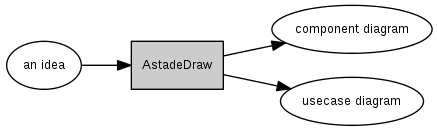
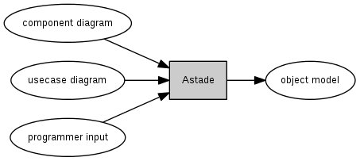
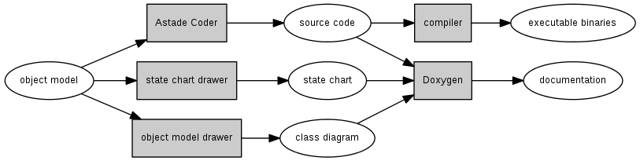

Astade – Model-Driven C and C++ Development
===========================================

Astade is an open-source UML modeling and code generation tool
for C and C++ software development.

Astade supports the complete software development process,
from initial design and architecture to implementation,
code generation, documentation, and continuous integration.

**Astade is entirely developed using Astade itself.**

Professional support, consulting, and custom development
are available directly from the original developer.

Design
------

Astade supports model-driven software design using UML.

Software structures and relationships are defined in the model,
which serves as the primary source for code generation.

This approach helps developers maintain a consistent software
architecture throughout the development process.

Architecture
------------

Astade allows developers to design and maintain software
architectures using UML models.

The model defines the structure of the application,
including classes and their relationships.

Astade follows a **Model-First Development** approach:
the software architecture is maintained in the model
rather than reconstructed from the source code.

Implementation
--------------

Astade generates C and C++ source code from UML models.

Developers implement the functionality within the
generated functions.

Astade supports a controlled round-trip mechanism:
existing function implementations can be transferred
back into the model.

This allows developers to modify implementations
without losing the benefits of model-driven development.

UML State Machines
------------------

Astade supports UML state machines and generates
corresponding source code directly from the model.

State machines provide a structured way to describe
event-driven behavior and complex control logic.

Typical applications include:

- Embedded systems
- Industrial automation
- Communication protocols
- Event-driven applications
- Control systems

By generating state machine implementations from UML models,
Astade helps maintain consistency between design
and implementation.

Developed with Astade
---------------------

**Astade is completely developed using Astade itself.**

The UML models of Astade are maintained using Astade,
and the corresponding source code is generated from
these models.

This demonstrates that Astade can be used to develop
and maintain substantial real-world software projects.

The complete source code is publicly available on GitHub:

[Astade on GitHub](https://github.com/alars/Astade)

Continuous Integration
----------------------

Astade uses Jenkins for continuous integration.

The existing CI infrastructure supports the development
and maintenance of the project.

You can access the Continuous Integration Server here:

[Astade Jenkins CI Server](http://dev.astade.de/)

Professional Support
--------------------

**Professional Astade support directly from the original developer.**

Thomas Spitzer, the original developer of Astade,
offers professional support, consulting, maintenance,
and custom development services.

Available services include:

- Installation and configuration
- Technical support and troubleshooting
- Bug fixing and maintenance
- Custom code generator development
- UML modeling and software architecture consulting
- State machine development
- Integration into existing development environments
- Custom features and enhancements
- Long-term maintenance and project support

Whether you are using Astade in an existing project
or considering it for new software development,
professional assistance is available.

**Contact:**

Thomas Spitzer  
Original Developer of Astade

Email: [t.spitzer@astade.de](mailto:t.spitzer@astade.de)

Project website: [astade.de](https://astade.de/)

Open Source
-----------

Astade is open-source software.

The source code is available on GitHub, allowing developers
to inspect, build, modify, and contribute to the project.

[Visit the Astade GitHub Repository](https://github.com/alars/Astade)

